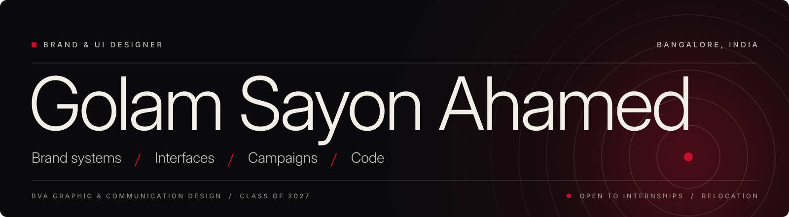

I'm a fourth-year design student who gets too interested in everything.
Branding, type, storytelling, code. I don't think that's a problem.
I think that's the whole point.

### Find me

### Right now

| Status | Details |
|---|---|
| **Studying** | BVA, Graphic & Communication Design at IDeA World College, Bangalore City University. 4th year, 7th semester, done in August 2027. |
| **Last internship** | Design Intern at RaazMD, a health-tech startup. Feb to Apr 2026. |
| **Looking for** | A 3 to 6 month internship in Product Design or Graphic Design. |
| **Where** | Open to remote and relocation. Germany first, then Dubai and Singapore. |

### Work

These are real projects. Campaign concepts, UI systems, live internship work, and things I made just to see if I could.

| Project | What it is |
|---|---|
| [Run Your Story](https://sayanahamed.online/run-your-story.html) | Campaign & Brand Concept |
| [Forge](https://sayanahamed.online/forge.html) | UI/UX Platform Design |
| [Marvel × A24](https://sayanahamed.online/marvel-a24.html) | Brand Reimagining |
| [RaazMD](https://sayanahamed.online/raazmd.html) | Internship, Brand & Campaign |
| [Other Work](https://sayanahamed.online/other-work.html) | Experiments & Side Projects |

Quick note: Forge above and PersonaForge below are two different projects. They only share a name and a few assets, because I reuse both.

### Currently working on

**PersonaForge** is my final year project, and I'm writing my thesis on it too.

Most personality tests give you a type and send you on your way. This one doesn't. You take the assessment, then you get the full breakdown: your strengths, weaknesses, habits, what actually motivates you, and how you can grow. Plus tips and recommendations you can use on a normal Tuesday.

Then comes the fun part. It matches you with fictional characters, worlds, teams, organizations and scenarios. Which fantasy world would you survive in? Which superhero team would take you? How would you work with your friends, and what would you do when things go wrong?

Understanding yourself should be useful, and it can be fun too. Both, not one or the other.

| Detail | PersonaForge |
|---|---|
| **Tagline** | Discover. Compare. Evolve. |
| **Type** | Final year project (BVA) with a written thesis |
| **Focus** | Assessment design, product design, interaction and visual design |
| **Build** | Single-file web app, runs fully in the browser, no accounts, no servers |
| **Status** | In development, about 34% done (Nov 2026) |

The thesis asks one thing: how do you design a personality assessment that people trust, and that feels like a starting point instead of a label? And does play help?

It's still being built, so expect rough edges.

### Shipped at RaazMD

**Design Intern, Brand & Campaign.** Health-tech startup, Bengaluru, Feb to Apr 2026.

I worked straight with the founders, managers and developers, and the work actually shipped. The Raaz MD app UI I worked on is live on Google Play, with 10K+ downloads. Real users, on real phones.

**The big two**

- **The mobile app.** I led the UI/UX start to finish: interaction logic, user flows, every screen.
- **Prescription and evaluation system.** Web, app and print. It went through 10+ iterations before it reached the dev team.

**Also**

- Website migration with a 3-person team, 30+ assets updated to keep the brand consistent
- Social assets across platforms, plus carousels and Meta ads for paid campaigns (my LinkedIn banner got adopted by 20+ employees)
- A YouTube thumbnail system, with 10+ thumbnails made
- WhatsApp templates for booking, consultation and engagement
- Merchandise, from brief to production-ready files
- Shot concepts and scene structure for video

### Tools I actually use

### GitHub activity

